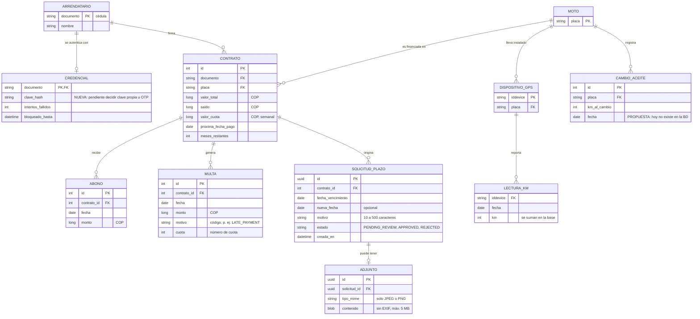

# Modelo entidad-relación — Aplicativo Móvil de Autogestión de Crédito

Motos del Caribe · Computación Móvil 2026-2 · Grupo 04

Este es el modelo **lógico** de lo que la app necesita. Separa lo que **ya existe** en la base de datos de la empresa (se lee, no se modifica) de lo que **hay que crear** (tablas propias del aplicativo). Los nombres de atributos son los del modelo de la app; la correspondencia con las tablas reales de la empresa está en la sección 3.

## 1. Diagrama

## 2. Entidades y de dónde salen

| Entidad | Origen | Qué guarda |
|---|---|---|
| ARRENDATARIO | Existente | Quién es el titular del crédito. |
| MOTO | Existente | La moto financiada, identificada por placa. |
| CONTRATO | Existente | Valor, saldo, cuota y próxima fecha de pago de un arrendatario sobre una moto. |
| ABONO | Existente | Cada pago recibido (recaudo). |
| MULTA | Existente | Cargos por pago tardío y similares. |
| DISPOSITIVO_GPS | Existente | Equipo instalado en la moto. Se une por `iddevice`, **no** por placa. |
| LECTURA_KM | Existente | Distancia reportada por el GPS; la app muestra la suma. |
| CREDENCIAL | **Nueva** | La BD no guarda credenciales de arrendatarios. Falta decidir entre clave propia y código OTP por WhatsApp. |
| SOLICITUD_PLAZO | **Nueva** | Petición de más plazo. Hoy vive en memoria de la API; debe pasar a una tabla propia y avisar a cobranza. |
| ADJUNTO | **Nueva** | Foto de soporte de la solicitud, re-codificada para quitar datos EXIF. |
| CAMBIO_ACEITE | **Propuesta** | No existe en la BD. Con ella la app avisaría el mantenimiento por kilometraje. |

## 3. Correspondencia con las tablas de la empresa (referencia del tablero de Power BI)

| Entidad del modelo | Tabla o vista de la empresa |
|---|---|
| CONTRATO (saldo, cuota) | `reporte_estado_motos` |
| ABONO | `vw_gd_recaudo_bruto` |
| CONTRATO (meses restantes) | `vw_gd_motos_app_proyeccion` |
| MULTA | `rentabilidad_activos` |
| LECTURA_KM | `vw_sv_hist_distancia` |
| DISPOSITIVO_GPS | `dispositivos` |
| MOTO ↔ DISPOSITIVO_GPS | `motos_app_hist` |

Las consultas de la app deben ir en **vistas propias de solo lectura**: la base de la empresa solo admite vistas nuevas, nunca cambios a tablas existentes.

## 4. Reglas que el modelo debe cumplir

- Un arrendatario puede tener varios contratos a lo largo del tiempo, pero la app muestra el activo.
- Una moto tiene un contrato vigente a la vez, aunque con los años pase por varios arrendatarios.
- Todo dato se consulta con la cédula **del token**, nunca con una enviada por el cliente.
- Una solicitud solo la ve su dueño; para cualquier otro usuario responde "no encontrada".
- `nueva_fecha`, si se envía, debe ser posterior a `fecha_vencimiento`.
- Una solicitud tiene a lo sumo un adjunto, y solo se aceptan imágenes JPEG o PNG (se valida el contenido real, no la extensión).

## 5. Qué hay hoy y qué falta

Hoy la demo usa **20 clientes ficticios** cargados desde un archivo (`seed/clients.json`) y guarda las solicitudes en memoria de la API, así que se pierden al reiniciar. Para pasar a datos reales faltan las tres piezas marcadas como nuevas o propuesta: credenciales, tabla de solicitudes con adjuntos y registro de cambio de aceite.
